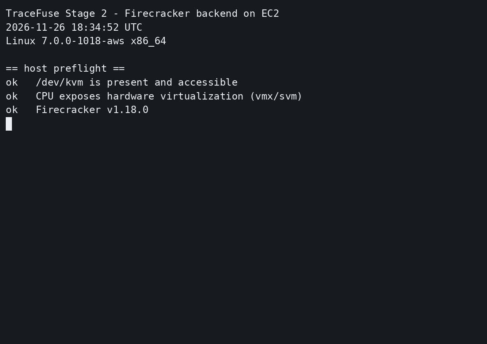

# TraceFuse

An adaptive Firecracker sandbox for AI-generated workloads.

> Observe the first execution, convert behaviour into a least-privilege policy,
> require approval, then replay the workload under that policy.

## Quick start (any laptop, ~1 minute)

```bash
make test        # unit tests: policy proposal, evaluation, diff, console protocol
make demo        # observe -> approve -> enforce -> attack blocked -> diff
make demo 2>&1 | tee demo.log && make verify-demo   # assert the security claims
```

The demo uses the **local** backend so you can work on the policy loop without
KVM. The local backend shares your kernel and is **not a security boundary**.

## Real isolation (Linux + KVM)

```bash
# 1. kernel with BTF + base rootfs (see guest/build-rootfs.sh header)
BASE_ROOTFS=ubuntu.ext4 KERNEL=vmlinux make guest
# 2. host TAP device, no NAT
./scripts/setup-tap.sh tf0
# 3. read-only preflight: KVM, kernel .BTF, rootfs, TAP, tools
make host-check
# 4. demo: the guest calls the mock API on the TAP gateway
TF_BACKEND=firecracker TF_TAP=tf0 make demo
```

With the firecracker backend the demo sets `TF_MOCK_HOST=172.16.0.1` so the
workload calls the host over the TAP device. A private address is only learned
because the operator passes it explicitly (`--trusted-hosts`, or
`TF_TRUSTED_HOSTS`). Cloud metadata and other link-local endpoints are never
learned, trusted or not.

## Verified Firecracker run

Exercised on an Ubuntu 26.04 x86_64 EC2 host with KVM, Firecracker v1.18.0 and
the Firecracker CI kernel 6.18.62:

- `make host-check` -> PASS (KVM, `.BTF` vmlinux, ext4 rootfs, TAP `tf0` at
  `172.16.0.1/30`).
- `TF_BACKEND=firecracker TF_TAP=tf0 make demo` -> PASS.
- `./scripts/verify-demo.sh demo.log` -> PASS.
- Under the approved policy, the useful workload exited 0 and returned the mock
  data; the same policy blocked the metadata endpoint `169.254.169.254:80`,
  `curl`, and `/etc/shadow`. The behavioural diff flagged the malicious variant
  as a regression.

Evidence: `reports/stage2-host-check.txt`, `reports/stage2-demo.log`,
`reports/stage2-verify-demo.txt`.

Recording: [watch the recorded run](https://asciinema.org/a/CSKovFSaPx55lxZy)
(online copy; retained for 7 days unless linked to an asciinema account). The
permanent cast is [`reports/stage2-demo.cast`](reports/stage2-demo.cast); play
it with `asciinema play reports/stage2-demo.cast`.

### Demo recording

[Watch the MP4](reports/stage2-demo.mp4)



The recording (~39 s) shows the Firecracker-backed demo on EC2: host preflight,
safe observe, policy approval, enforcement, malicious variant blocked, and
`verify-demo: PASS`.

Operational notes:

- Use `TMPDIR="$HOME/tmp"` when `/tmp` is a small tmpfs; the backend copies the
  2 GiB rootfs for each VM.
- The CI kernel lacks `NF_LOG_IPV4`; the nftables rules omit `log prefix` and
  still fail closed.
- `guest/build-rootfs.sh` bind-mounts `/dev`, `/dev/pts`, `/proc`, and `/sys`
  so apt works inside the chroot.

## Commands

| Command | What it does |
|---|---|
| `tracefuse run --code f.py --mode observe` | run once, record trace, propose policy (unapproved) |
| `tracefuse policy show ID` / `approve ID` | review / approve a proposal |
| `tracefuse run --code f.py --mode enforce --policy ID` | run under an approved policy, fail closed |
| `tracefuse diff A B` | behavioural regression between two traces |
| `tracefuse report ID` | full JSON trace (the "security receipt") |

## Layout

```
cmd/tracefuse/          CLI
internal/firecracker/   microVM lifecycle over the Firecracker REST API (+ snapshots)
internal/sandbox/       backends: firecracker (real) and local (dev); tracer.py policy agent
internal/policy/        propose / evaluate / nftables rendering, safe baseline
internal/diff/          behavioural diffing
internal/trace/         event schema
internal/report/        timelines, findings, cross-checks
guest/                  init (PID 1), bpftrace observer, rootfs build
demos/                  safe, useful, malicious programs + mock API
docs/                   architecture, threat model, and EXPLAINER.md (start here)
```

New to the code? Read [`docs/EXPLAINER.md`](docs/EXPLAINER.md): a plain-English
tour with diagrams, OS background, feature recipes and a debugging playbook.

## Security rules this code enforces

1. Observation never grants permission. Findings (metadata IPs, private ranges,
   shells, sensitive files, privilege changes) are excluded from proposals.
   Private ranges stay excluded unless the operator allowlists a specific
   host:port (`--trusted-hosts`, used for the Firecracker TAP gateway).
2. Enforce mode refuses unapproved policies.
3. Baseline deny applies in every mode (metadata endpoints, `/etc/shadow`, ...).
4. Network enforcement in the guest fails closed (nftables `policy drop`).
5. Host eBPF does not see guest processes; observation lives in the guest and
   the controller treats everything from the guest as untrusted input.
6. seccomp: dangerous syscalls (ptrace, bpf, mount, kexec, module loading,
   unshare/setns...) are refused in every mode; in enforce mode only syscalls
   eBPF saw during the approved observe run are allowed (default EPERM), plus
   a small fixed set for signals, memory and a clean shutdown. `TF_SECCOMP_STRICT=1`
   removes that runtime set; `TF_REQUIRE_SECCOMP=1` fails closed (exit 126) when
   libseccomp is missing or the learned allowlist is empty.
   An OCI-style `seccomp.json` is generated with every enforced run.

## Not yet (roadmap weeks 6-8)

arm64 syscall tables, snapshot-restore fast path in the CLI, vsock channel
instead of serial, signed trace receipts, IPv6, a web UI. See `docs/`.

## Sources

Firecracker design doc, Firecracker announcement, Fly.io sandboxing posts,
Modal sandbox posts, Datadog eBPF hardening lessons, CubeSandbox networking.
