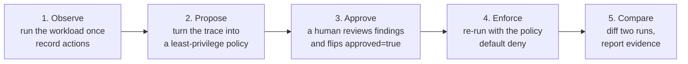
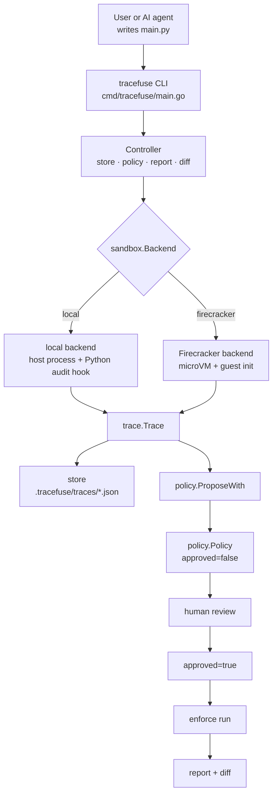
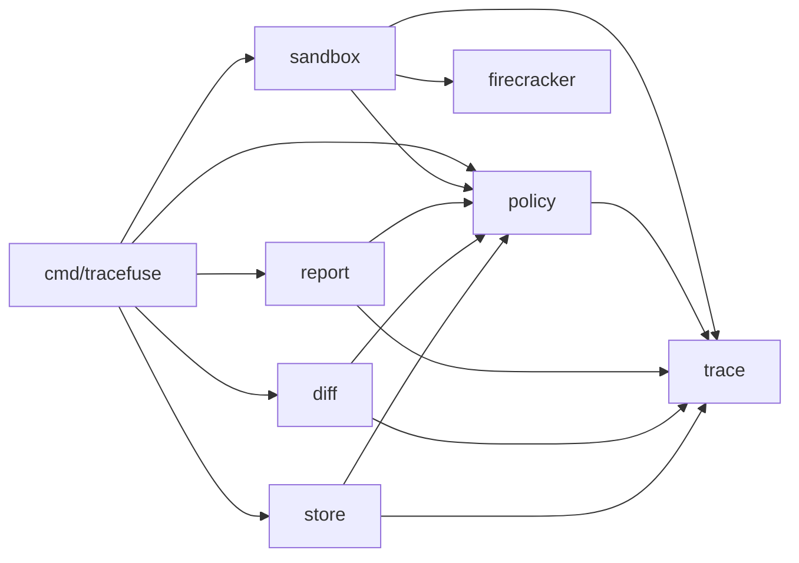
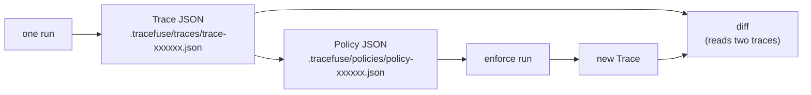
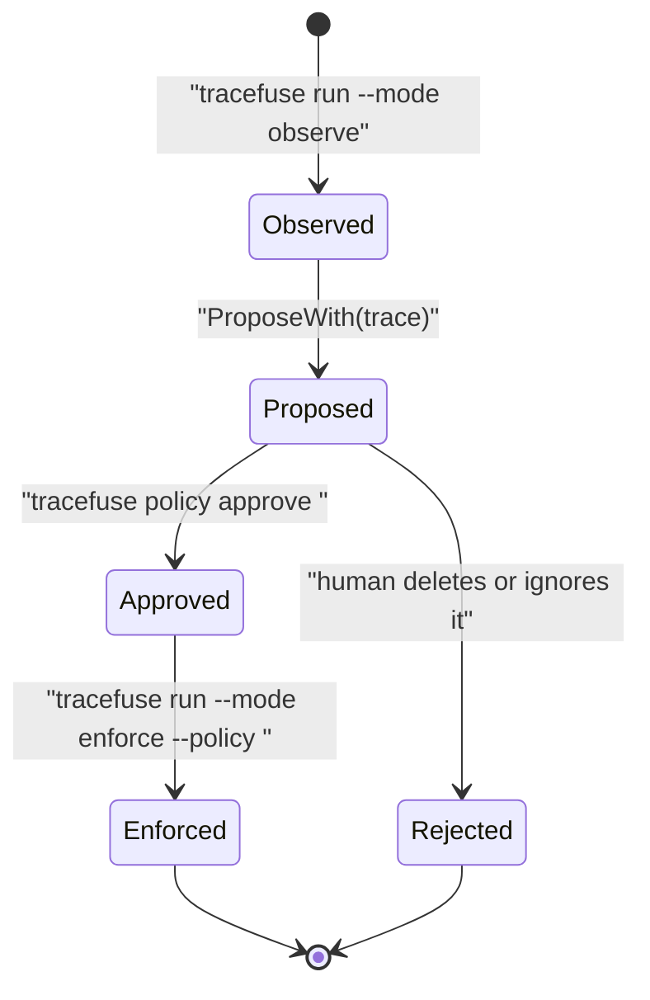
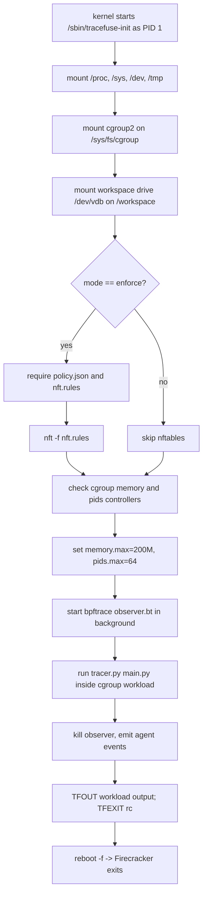
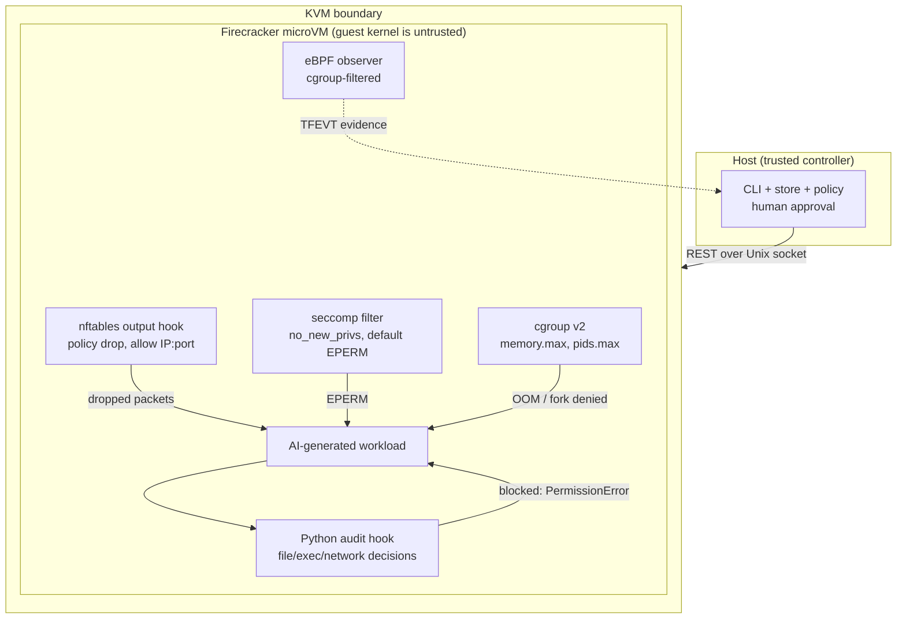
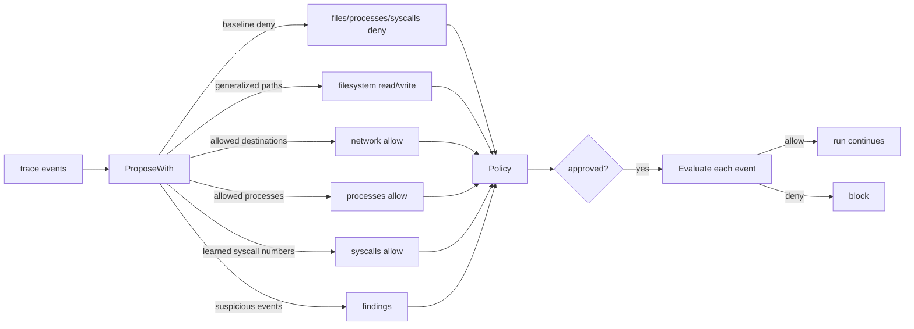

# TraceFuse: a guided tour for a new developer

This document is written for a backend developer who has never seen this
repository. Read it top to bottom once; you should then be able to explain the
architecture, trace one run end to end, and add a feature without guessing.

If you only have five minutes, read sections 1, 2, 3 and 7. Come back for the
rest when you touch the guest or the policy engine.

---

## Contents

1. What TraceFuse is, in one page
2. The idea: observe, propose, approve, enforce
3. Glossary
4. System map
5. Data model
6. Modes and the policy lifecycle
7. Execution flow: an observe run (local backend)
8. Execution flow: an enforce run (Firecracker backend)
9. Inside the guest: boot and `tracefuse-init`
10. Observation, layer 1: the eBPF observer
11. Observation, layer 2: the Python audit hook
12. Enforcement layers
13. The policy engine
14. Reporting, cross-check and diff
15. Storage, IDs and state
16. Operating-system concepts you need
17. Trust boundaries and threat model
18. Running it
19. Adding a feature: recipes
20. Debugging playbook
21. Reading order and self-check
22. Known gaps and roadmap

---

## 1. What TraceFuse is, in one page

TraceFuse runs an AI-generated Python program in a disposable sandbox, records
what the program actually does, turns that behaviour into a least-privilege
policy, asks a human to approve it, and then re-runs the program under that
policy.

The problem it solves: an AI agent can write code that looks correct and still
reads `/etc/shadow`, calls the cloud metadata service, or opens a connection to
an attacker. Reviewing the source is not enough, because libraries and
subprocesses hide behaviour. TraceFuse watches the first execution at the
kernel and interpreter level, then constrains later executions to that observed
footprint.

The important security rule is in the package comment of
`internal/policy/policy.go`:

> Observation never grants permission by itself. Suspicious behaviour is
> reported as a Finding and kept OUT of the proposed allowlist.

So the first run is not "trusted because we saw it". It is evidence. A human
decides what becomes policy.

TraceFuse is not a general container runtime and not a full security product.
It is a small, readable implementation of the observe-then-enforce loop, with a
real Firecracker backend and a developer-friendly local backend.

---

## 2. The idea: observe, propose, approve, enforce



Two facts make this useful:

- **Behaviour is harder to fake than output.** Two programs can print the same
  JSON and do completely different things. The trace records syscalls, files,
  destinations and processes.
- **Least privilege needs a starting point.** Writing an allowlist by hand is
  error-prone. Observing a known-good run gives a concrete starting point,
  which a human then reviews.

The demo in `scripts/demo.sh` walks exactly this loop:

1. A safe program is observed.
2. A useful program is observed; its local API destination is learned.
3. The proposal is approved.
4. The useful program runs successfully under enforcement.
5. A malicious variant is blocked under the same policy.
6. The malicious variant is observed; its bad actions are findings, not
   permissions.
7. A behavioural diff shows the regression.

---

## 3. Glossary

Plain meanings first, then the technical name.

| Term | Plain meaning | Where it appears |
|---|---|---|
| Sandbox | A disposable place to run code so it cannot touch your real machine. | `internal/sandbox` |
| Workload | The Python file the AI agent produced. | `demos/*.py`, `job.CodePath` |
| Trace | The recorded list of things the workload did. | `internal/trace`, `.tracefuse/traces` |
| Event | One recorded action: exec, file open, connect, syscall, exit. | `trace.Event` |
| Policy | The allowlist/denylist learned from a trace, after human approval. | `policy.Policy` |
| Finding | Something suspicious that a human should review; never auto-allowed. | `policy.Finding` |
| Observe mode | Run and record; baseline blocks still apply. | `--mode observe` |
| Enforce mode | Run under an approved policy; default deny. | `--mode enforce` |
| Backend | The thing that actually runs the workload. | `sandbox.Backend` |
| Local backend | Runs on your host as a normal process. Fast, not a security boundary. | `internal/sandbox/local.go` |
| Firecracker backend | Runs inside a KVM microVM. The real isolation. | `internal/sandbox/firecracker.go` |
| MicroVM | A tiny virtual machine with its own kernel, booted in milliseconds. | Firecracker |
| Hypervisor / VMM | Software that runs virtual machines; Firecracker is the VMM here. | `internal/firecracker` |
| KVM | Linux's kernel virtual-machine interface (`/dev/kvm`). | host requirement |
| Syscall | The kernel API a program calls to open files, connect sockets, etc. | observer, seccomp |
| eBPF | A safe way to run small programs inside the kernel to observe or filter events. | `guest/observer.bt` |
| bpftrace | A high-level language that compiles to eBPF. | `observer.bt` |
| BTF | Kernel type information that lets eBPF programs read kernel structures by name. | kernel config |
| Audit hook | A Python callback that sees high-level operations before they happen. | `tracer.py` |
| seccomp | A per-process kernel filter that allows or denies syscall numbers. | `seccomp.go`, `tracer.py` |
| nftables | The Linux packet filter; kernel-level network allow/deny. | `network.go` |
| cgroup v2 | A kernel mechanism to group processes and limit memory/CPU/PIDs. | `tracefuse-init` |
| TAP device | A virtual network interface that connects a VM to the host. | `scripts/setup-tap.sh` |
| PID 1 / init | The first process in a Linux system; it mounts filesystems and starts everything. | `guest/tracefuse-init` |
| JSONL | A file with one JSON object per line; easy to stream and parse. | events, traces |
| Unix domain socket | A socket addressed by a filesystem path, local to one machine. | Firecracker API |
| ext4 image | A filesystem stored in a file, used as a virtual disk. | rootfs, workspace |
| Glob | A pattern like `/usr/lib/**` that matches paths. | `MatchAny` |
| Allowlist / denylist | Explicitly permitted / explicitly forbidden. | policy fields |

---

## 4. System map

Figure 1: the controller and the two backends.



Figure 2: Go package dependencies. Arrows mean "imports".



Component responsibilities:

| Path | Responsibility |
|---|---|
| `cmd/tracefuse/main.go` | Flag parsing, command dispatch, load/save, wiring. No sandbox logic. |
| `internal/sandbox/sandbox.go` | `Job`, `Backend` interface, backend selection, small helpers. |
| `internal/sandbox/local.go` | Runs the workload as a host process under `tracer.py`. |
| `internal/sandbox/firecracker.go` | Builds drives, starts the VM, parses the console protocol. |
| `internal/firecracker/vm.go` | Firecracker REST API over a Unix socket; lifecycle, snapshots. |
| `internal/sandbox/tracer.py` | Audit-hook agent, decision logic, seccomp, event emission. |
| `guest/tracefuse-init` | PID 1 in the guest: mounts, nftables, cgroups, observer, workload. |
| `guest/observer.bt` | eBPF observation of the workload cgroup. |
| `internal/policy/policy.go` | `ProposeWith`, `Evaluate`, classification, glob matching. |
| `internal/policy/network.go` | nftables rules and `/etc/hosts` pins from a policy. |
| `internal/policy/seccomp.go` | Baseline deny syscalls and OCI-style seccomp JSON. |
| `internal/trace/trace.go` | Event/Trace schema, JSONL parsing, normalisation. |
| `internal/report/report.go` | Human-readable timeline, findings, cross-check. |
| `internal/diff/diff.go` | Behavioural footprint comparison. |
| `internal/store/store.go` | JSON persistence and IDs. |
| `scripts/demo.sh` | End-to-end demonstration. |
| `scripts/verify-demo.sh` | Asserts the demo's security claims from a log. |

The dependency rule is deliberate: `policy` and `trace` are pure data and logic;
`sandbox` knows how to execute; `cmd` wires them. If you add a feature, put the
logic in the lowest package that can own it, not in `main`.

---

## 5. Data model

### Event

One observed or blocked action (`internal/trace/trace.go`):

```json
{
  "sandbox_id": "sb-1a2b3c",
  "timestamp": "2026-11-25T20:13:27.123Z",
  "event": "network_connect",
  "source": "audit",
  "process": "python3",
  "pid": 41,
  "destination": "127.0.0.1:8080",
  "action": "observed",
  "reason": ""
}
```

Event types: `exec`, `file_open`, `network_connect`, `dns`, `process_exit`,
`syscall`, `priv_change`, `mount`.

`source` is `ebpf`, `audit` or `nftables`. `action` is `observed` or `blocked`.

### Trace

The full record of one run: metadata plus `[]Event`, stdout, stderr, console
tail, exit code, timeout flag. A trace is the evidence you keep.

### Policy

```json
{
  "id": "policy-1a2b3c",
  "source_trace": "trace-1a2b3c",
  "approved": false,
  "filesystem": { "read": ["/usr/lib/python3.12/**"], "write": ["/tmp/**"], "deny": ["/etc/shadow"] },
  "network": { "allow": ["127.0.0.1:8080"] },
  "processes": { "allow": [], "deny": ["bash", "curl", "sh"] },
  "syscalls": { "arch": "x86_64", "allow": [0, 1, 2], "deny": ["ptrace", "mount"] },
  "limits": { "timeout_sec": 30, "memory_mb": 256, "vcpus": 1 },
  "findings": []
}
```

The `filesystem.read`/`write` entries are globs, not exact paths, because
Python reads hundreds of library files. `Generalize` collapses them.

### Finding

A review item: severity (`low`, `medium`, `high`, `critical`), a kind such as
`sensitive_file` or `shell_or_network_tool`, and a detail string. Findings are
stored in the policy for the reviewer but are not permissions.

### Where each piece lives



IDs are generated by `store.NewID`: three random bytes, hex-encoded, so
`trace-1a2b3c`. A policy ID is derived from its trace ID by replacing the
prefix (`PolicyIDFor`).

---

## 6. Modes and the policy lifecycle



Observe mode:

- Baseline denials still apply (sensitive files, metadata endpoints).
- Everything else is recorded and allowed.
- At the end, a policy is proposed and saved with `approved=false`.

Enforce mode:

- The CLI requires `--policy` and refuses an unapproved policy.
- The policy's `limits.timeout_sec` and `limits.memory_mb` override CLI flags.
- The workload runs with default deny at every layer.

The human approval step is the only thing that turns observation into
permission. `tracefuse policy approve` only flips the flag; it does not edit the
allowlist. Findings that were excluded from the proposal stay excluded.

---

## 7. Execution flow: an observe run (local backend)

This is the path used by `make demo` and by CI, because it needs no KVM.

```mermaid
sequenceDiagram
    autonumber
    participant CLI as "tracefuse CLI"
    participant BE as "localBackend"
    participant PY as "python3 -I -B tracer.py"
    participant H as "audit hook"
    participant FS as "events.jsonl"
    participant ST as "store"
    participant POL as "policy.ProposeWith"

    CLI->>BE: Run(job: observe, code path, timeout)
    BE->>BE: mkdtemp; copy code to workspace/main.py
    BE->>BE: write tracer.py; minimal env; TF_EVENTS
    BE->>PY: exec.CommandContext(python, -I, -B, tracer, main.py)
    PY->>H: sys.addaudithook(hook)
    PY->>PY: runpy.run_path(main.py, "__main__")
    H-->>FS: append one JSON object per action
    PY-->>BE: exit code, stdout, stderr
    BE->>FS: read all events
    BE-->>CLI: Trace{events, stdout, exit}
    CLI->>ST: SaveTrace(trace)
    CLI->>POL: ProposeWith(trace, trusted hosts)
    POL-->>CLI: Policy + findings
    CLI->>ST: SavePolicy(policy, approved=false)
    CLI-->>CLI: print timeline + findings + next commands
```

Key details in `internal/sandbox/local.go`:

- The temp directory is removed on return (`defer os.RemoveAll`). Nothing
  survives the run except the trace saved by the controller.
- The environment is rebuilt from scratch: `HOME` and `TMPDIR` point into the
  temp directory, so the workload cannot read the developer's home directory
  through those variables. `PATH` is inherited; this is a dev backend, not a
  boundary.
- `-I` means isolated Python mode: ignore `PYTHON*` environment variables and
  the user site directory. `-B` stops `.pyc` writes, which would otherwise add
  noise and write outside the workspace.
- `exec.CommandContext` kills the process when the timeout expires.
- Events are read after the process exits. The tracer writes JSONL with
  line buffering, so a crash still leaves the events written so far.

What the workload sees:

- `main.py` in its current directory.
- `TF_MODE`, `TF_WORKSPACE`, `TF_TMP`, `TF_MOCK_HOST`, and, in enforce mode,
  `TF_POLICY` (a path to the JSON policy).
- No database, no cloud credentials, no host home directory.

The `demos/useful.py` program reads `TF_MOCK_HOST` and calls
`http://<host>:8080/data`; the mock server in `demos/mock_server.py` answers.
That is why the demo can run entirely offline.

---

## 8. Execution flow: an enforce run (Firecracker backend)

This is the real isolation path. It needs Linux, `/dev/kvm`, a Firecracker
binary, a kernel with BTF, a guest rootfs, and a TAP device if the workload
needs the host.

```mermaid
sequenceDiagram
    autonumber
    participant CLI as "tracefuse CLI"
    participant FC as "fcBackend"
    participant VMM as "Firecracker VMM"
    participant INIT as "guest init (PID 1)"
    participant NFT as "nftables"
    participant BPF as "bpftrace observer"
    participant TR as "tracer.py"
    participant CON as "ttyS0 console"

    CLI->>FC: Run(job: enforce, approved policy)
    FC->>FC: build workspace.ext4 from workspace/
    FC->>FC: copy rootfs.ext4 per VM
    FC->>VMM: Start(); REST: machine-config, boot-source, drives, net
    FC->>VMM: PUT /actions InstanceStart
    VMM->>INIT: boot with init=/sbin/tracefuse-init
    INIT->>INIT: mount proc, sys, dev, tmp, cgroup2, /dev/vdb
    INIT->>NFT: nft -f nft.rules (policy drop)
    INIT->>BPF: start observer filtered to cgroup "workload"
    INIT->>TR: run in cgroup with policy env
    TR-->>INIT: decisions, agent JSONL
    BPF-->>CON: TFEVT lines
    INIT-->>CON: TFOUT, TFEXIT
    VMM-->>FC: serial stream
    FC->>FC: parse lines into Trace
    FC-->>CLI: Trace
```

What `fcBackend.Run` prepares:

1. A temp root directory.
2. `workspace/main.py` (the workload) and `workspace/.tracefuse/` metadata:
   `mode`, `mock_host`, and, for enforce, `policy.json`, `nft.rules`, `hosts`,
   `seccomp.json`.
3. A 64 MiB ext4 image built from that directory with
   `mkfs.ext4 -q -d workspace workspace.ext4`.
4. A private copy of the base rootfs, so two runs cannot share state.

Then `firecracker.VM.Start`:

- Removes any stale API socket.
- Starts `firecracker --api-sock <path>` with stdout/stderr piped into an
  `io.Pipe` (the console).
- Waits for the socket to appear.
- Sends REST `PUT` requests over the Unix socket:
  `/machine-config`, `/boot-source`, `/drives/rootfs`, `/drives/workspace`,
  optionally `/network-interfaces/eth0`, then `/actions` with
  `InstanceStart`.

The boot arguments include `console=ttyS0 reboot=k panic=1 pci=off
init=/sbin/tracefuse-init`. `reboot=k` tells Firecracker to exit the VMM when
the guest calls `reboot`, instead of rebooting forever. That is how a run ends.

The console protocol is a text protocol:

| Prefix | Meaning |
|---|---|
| `TFEVT {json}` | One event from eBPF or the audit agent. |
| `TFOUT text` | Workload stdout/stderr line. |
| `TFEXIT n` | Workload exit status. |
| `... TFBLOCK ...` | Kernel log line from an nftables drop. |

`handleConsoleLine` parses each line. Malformed JSON is skipped, because the
guest is untrusted. `parseNFLog` extracts `DST=` and `DPT=` from a blocked
packet log line and turns it into a `network_connect` event with
`action=blocked`.

Timeout behaviour: `Run` starts `vm.Wait()` in a goroutine and selects on the
wait result or the context deadline. On timeout it sets `TimedOut`, calls
`vm.Destroy()`, waits for the reaper, and returns. `ExitCode` stays `-1` if the
guest never sent `TFEXIT`.

`VM.Wait` is idempotent (`sync.Once`); `VM.Destroy` kills the VMM, closes the
console pipe, reaps the process with a five-second bound, and removes the
socket. This matters because `Start` cleans up on any API failure and the caller
also defers `Destroy`.

---

## 9. Inside the guest: boot and `tracefuse-init`

`guest/tracefuse-init` is the first process. There is no systemd, no shell
login, no package manager at boot. It does exactly this:



Why each step exists:

- **Mounts**: a fresh kernel has no mounted filesystems. `/proc` and `/sys` are
  needed by Python, bpftrace and the network setup. `/tmp` is a tmpfs so writes
  stay in memory and vanish on reboot.
- **cgroup2**: needed for resource limits and for the eBPF cgroup filter.
- **`/dev/vdb`**: Firecracker exposes the workspace as the second virtio block
  device. The rootfs is `/dev/vda`.
- **enforce checks**: a missing policy, missing nftables rules or missing `nft`
  binary means the sandbox cannot enforce. The init prints `TFOUT ...` and
  `TFEXIT 126`, then powers off. It does not continue in a weaker mode.
- **cgroup checks**: if the kernel lacks the memory or pids controller, the run
  fails closed. Resource limits are part of the contract.
- **observer**: bpftrace is optional in the sense that init warns and continues
  if it cannot attach. But in the guest, the tracer is started with
  `TF_REQUIRE_SECCOMP=1`; if eBPF never recorded any syscalls, the learned
  allowlist is empty and the tracer refuses enforce mode with exit 126. In
  practice, a working eBPF observer is required for enforce runs.
- **workload**: `env -i` gives a minimal environment. `sh -c 'echo $$ >
  cgroup.procs; exec "$@"'` moves the process into the `workload` cgroup before
  exec, so the workload and its children are counted and observed.
- **power off**: `reboot -f` triggers the kernel reboot path; Firecracker's
  `reboot=k` makes the VMM exit.

Failure mode: `fail()` writes a human-readable `TFOUT` line, `TFEXIT 126`, and
powers off. The controller records exit code 126 and the reason in the console
tail.

---

## 10. Observation, layer 1: the eBPF observer

`guest/observer.bt` runs inside the guest, next to the workload. It attaches to
kernel tracepoints and prints one JSON object per line. `tracefuse-init` pipes
that output through `emit`, which prefixes each line with `TFEVT `.

What it observes:

| Tracepoint | Event |
|---|---|
| `syscalls:sys_enter_execve` | `exec` |
| `syscalls:sys_enter_openat` | `file_open` with raw flags |
| `syscalls:sys_enter_connect` | `network_connect` (IPv4 only) |
| `syscalls:sys_enter_setuid`, `setgid`, `capset` | `priv_change` |
| `syscalls:sys_enter_mount` | `mount` |
| `raw_syscalls:sys_enter` | `syscall` first use per number |
| `sched:sched_process_exit` | `process_exit` |

Every probe is filtered by:

```c
/cgroup == cgroupid("/sys/fs/cgroup/workload")/
```

That is why the observer does not record init, bpftrace itself, or unrelated
kernel activity. `cgroupid()` returns the kernel ID of the cgroup directory;
the tracepoint's `cgroup` field is the ID of the process's cgroup.

The `@seen` map implements "first use of each syscall number". That gives the
policy a syscall allowlist without recording every syscall (which would be huge).
The map is cleared in `END`.

Limitations you must know:

- IPv4 only. The `connect` probe casts to `sockaddr_in` and ignores IPv6.
- Paths are printed with `%s` and are not JSON-escaped. A path containing a
  quote can produce malformed JSON, which the controller skips.
- `syscall` events have no timestamp from eBPF; the controller fills one when
  parsing. The trace order for those events is parse order, not exact time.
- A compromised guest kernel can disable or falsify eBPF. The threat model
  accepts this; the KVM boundary is what protects the host.

Why eBPF at all: it is the kernel's own view. The Python audit hook is inside
the interpreter and can be bypassed by a subprocess or a C extension. The two
signals are cross-checked.

---

## 11. Observation, layer 2: the Python audit hook

`internal/sandbox/tracer.py` runs the workload in the same Python process and
installs an audit hook (PEP 578). The hook sees high-level operations before
they happen and can raise `PermissionError` to block them.

Why the same process: the hook must see Python-level calls with their arguments
(path, mode, destination). A separate process would only see syscalls, without
Python context.

The hook translates a small set of audit events:

| Audit event | Trace event |
|---|---|
| `open` | `file_open` with `r`/`w` |
| `socket.getaddrinfo` | `dns` |
| `socket.connect` | `network_connect` |
| `subprocess.Popen` | `exec` |
| `os.exec`, `os.posix_spawn` | `exec` |
| `os.system` | `exec` (as `sh`) |

Everything else is ignored, which keeps noise down.

Two implementation details matter:

- **`_busy` guard**: emitting an event writes to a file, which itself triggers
  audit events. Without the guard, the hook would recurse. The guard drops
  nested events while one decision is in progress.
- **Pre-imported `traceback`**: the module is imported before the hook is
  installed. Importing it later would cause file reads after enforcement starts
  and could be blocked by the policy, hiding the real error.

Path normalisation (`vpath`) maps the real temp workspace and temp directory to
the stable virtual paths `/workspace` and `/tmp`. That makes a policy learned on
one machine meaningful on another, and it matches the guest layout.

Decision logic (`decide`):

1. Baseline applies in every mode: sensitive files and metadata endpoints are
   blocked even during observe.
2. If mode is not enforce, or there is no policy, allow.
3. In enforce:
   - `exec`: denied names first, then must be in `processes.allow`.
   - `file_open`: policy deny globs; writes must match `filesystem.write`;
     reads must match `filesystem.read` or `filesystem.write`.
   - `dns`/`network_connect`: destination must be exactly in
     `network.allow`.

If denied, the hook emits `action=blocked` and raises `PermissionError`; the
workload sees an exception. If allowed, it emits `action=observed`.

`apply_seccomp` runs after imports and before the workload. It uses
`python3-seccomp` (libseccomp):

- Observe: default allow, baseline dangerous syscalls return `EPERM`.
- Enforce: default `EPERM`, only learned syscall numbers plus a small
  `ALWAYS_ALLOW` (clean shutdown) and `RUNTIME_ALLOW` (signals, memory, timers)
  are allowed. `TF_SECCOMP_STRICT=1` removes `RUNTIME_ALLOW`.
- If `TF_REQUIRE_SECCOMP=1` and libseccomp is missing, or enforce has no learned
  syscalls, the process exits 126. This is the guest's fail-closed path.
- `f.load()` sets `no_new_privs`; the filter cannot be removed.

The local backend does not set `TF_REQUIRE_SECCOMP`, so seccomp is best-effort
on a laptop. The guest always sets it.

Memory: in the guest, cgroup `memory.max` is the limit. On the local Linux
backend, `resource.setrlimit(RLIMIT_AS)` is used instead.

---

## 12. Enforcement layers

Figure 7: defence in depth. The outer layers are stronger but less precise; the
inner layers are precise but easier to bypass.



Layer by layer:

| Layer | Enforces | Strength | Bypass |
|---|---|---|---|
| KVM / Firecracker | Host isolation | Strong | Guest kernel exploit is out of scope |
| nftables | Network destinations | Strong, kernel-level | Guest root can change rules (but init loads them; cross-check reports) |
| seccomp | Syscall set | Strong, kernel-level | Must be installed before workload; missing lib fails closed in guest |
| cgroup v2 | Memory and PID count | Strong, kernel-level | None for the workload |
| audit hook | File/exec/network intent | Precise, early | Subprocesses and C extensions bypass it; nftables/seccomp back it up |
| policy approval | Human judgement | Process control | A careless reviewer can approve a bad policy |

The design principle: **each layer is useful alone, and the layers are
independent**. The audit hook gives good error messages and blocks early;
nftables and seccomp still hold if the hook is bypassed; KVM holds if the guest
is compromised.

`internal/policy/network.go` renders nftables:

```
flush ruleset
table ip tracefuse {
  chain output {
    type filter hook output priority 0; policy drop;
    oif "lo" accept
    ct state established,related accept
    ip daddr 169.254.0.0/16 log prefix "TFBLOCK " drop
    ip daddr <allowed-ip> tcp dport <port> accept
    log prefix "TFBLOCK " drop
  }
}
```

- `policy drop` is the default deny.
- Loopback is allowed (the demo's local API).
- Established/related traffic is allowed so replies work.
- Metadata is logged and dropped explicitly, even if someone allowlists it.
- Each allowed destination becomes an exact `ip daddr <ip> tcp dport <port>`
  rule. Hostnames are resolved on the controller, and `/etc/hosts` pins are
  written into the workspace, because the guest has no DNS server.
- Rules are TCP only: UDP egress is dropped even for a learned destination.
- IPv4 only; IPv6 is a roadmap item.

---

## 13. The policy engine

Figure 10: from events to policy and back.



### ProposeWith

`internal/policy/policy.go` builds a policy from a trace:

- Starts with baseline denies for files, processes and syscalls.
- Sets limits: timeout is `max(5s, duration_ms * 3 / 1000)` using integer
  arithmetic, memory 256 MB, 1 vCPU. The factor of three gives headroom for a
  slower enforcement run.
- For each event:
  - `blocked` events become `high` findings and are not learned.
  - `exec`: shell/network tools become `high` findings; package managers become
    `medium`; anything else is added to `processes.allow`.
  - `file_open`: sensitive files become `critical`; writes outside `/tmp`
    become `medium`; the path is generalized and added to read or write.
  - `network_connect`/`dns`: metadata/link-local are `critical` and never
    learned; private ranges are `high` and excluded unless the operator listed
    the exact host or `host:port` in `--trusted-hosts` (then `medium` finding
    but still learned); loopback is `low` and learned; public is learned.
  - `syscall`: baseline dangerous numbers become `high` findings and are
    excluded; the rest are added to the allowlist.
  - `priv_change`/`mount`: `high` findings; not learned.
- Findings are deduplicated by `kind|detail`.

The `--trusted-hosts` escape hatch exists for the Firecracker demo: the mock API
listens on the TAP gateway `172.16.0.1`, which is a private address. Without
trust, the proposal deliberately refuses to learn it.

### Generalize

`Generalize` turns concrete paths into reviewable globs:

- `/tmp/...` -> `/tmp/**`
- `/workspace/...` -> `/workspace/**`
- paths with two or fewer segments stay exact
- longer paths keep the first three segments and add `/**`

This is why a policy is readable and portable, and why it is less precise than
a full path list. The trade-off is deliberate: Python's standard library has
thousands of files.

### Evaluate

`Evaluate` is used by `report.CrossCheck` and is the reference semantics for
the tracer:

- `exec`: deny list, then allow list.
- `file_open`: deny list plus baseline; writes need `filesystem.write`; reads
  need `filesystem.read` or `filesystem.write`.
- `network_connect`/`dns`: critical destinations always denied; otherwise exact
  match in `network.allow`.
- `syscall`: baseline deny; if `syscalls.allow` is non-empty, the number must be
  present; if empty, only the baseline applies.
- `priv_change`/`mount`: always denied.

### Artifacts

- `NetworkArtifacts` produces the nftables rules and `/etc/hosts` pins.
- `SeccompProfile` produces an OCI/Docker-style JSON profile. If no syscalls
  were learned, the default action is `SCMP_ACT_ALLOW` with the baseline deny
  list; otherwise the default is `SCMP_ACT_ERRNO` and only the learned numbers
  are allowed.

---

## 14. Reporting, cross-check and diff

`tracefuse run` prints a timeline. Interpreter/library reads and individual
syscalls are summarised; everything else is listed with a timestamp and a
`BLOCKED` tag when applicable. The run ends with `sandbox destroyed`.

`tracefuse report <trace>` prints the raw JSON trace. This is the "security
receipt": inputs, outputs, events, exit code, timeout flag.

`report.CrossCheck` re-evaluates every non-blocked event against the policy.
With the Firecracker backend, eBPF evidence is independent of the in-guest
agent, so a disagreement means something was observed that the policy does not
allow, i.e. it slipped past in-guest enforcement. Those lines are printed under
`--- observed but NOT prevented (investigate) ---`.

`tracefuse diff A B` compares footprints:

- files read
- network destinations
- processes
- blocked action count
- duration

A regression is reported when B has an added file, destination or process, or
more blocked actions. The diff is intentionally about behaviour, not output:
two versions can print identical results and behave differently.

---

## 15. Storage, IDs and state

Default state directory: `.tracefuse` (override with `TRACEFUSE_STATE`).

```
.tracefuse/
  traces/trace-xxxxxx.json
  policies/policy-xxxxxx.json
  last_trace
```

- `last_trace` contains the most recent trace ID; `scripts/demo.sh` uses it to
  chain steps.
- `LoadTrace` accepts an ID or a path.
- `LoadPolicy` accepts a policy ID or the trace ID it came from.
- Files are written with `os.MkdirAll` and mode `0644`; policies contain no
  secrets.

IDs are not security tokens. They are short, random and convenient. Do not rely
on them for authorization.

---

## 16. Operating-system concepts you need

### User space vs kernel space, and syscalls

A normal program runs in user space and cannot touch hardware or other
processes directly. It asks the kernel through syscalls: `openat`, `connect`,
`execve`, `mmap`, and so on. TraceFuse observes at this boundary (eBPF) and
filters at this boundary (seccomp). That is why the guarantees survive a
misbehaving Python library.

### Processes, PID 1 and init

Every Linux system has a process tree. PID 1 is special: it is the first
process, it inherits orphaned children, and when it exits the kernel panics (or
the VM stops). In this guest, `tracefuse-init` is PID 1. It must mount
filesystems, start the workload, reap it, and power off. There is no systemd,
so nothing else does this for you.

`reboot -f` calls the reboot syscall. Firecracker is configured with
`reboot=k`, which means "exit the VMM on guest reboot" instead of restarting
the guest. This is the clean shutdown path.

### File descriptors and open flags

When a process opens a file, the kernel returns a small integer: a file
descriptor. The `open` flags say whether it is read-only, write-only,
read-write, or create. The tracer records `r`/`w`; eBPF records the raw numeric
flags. `policy.IsWrite` understands both.

### cgroups v2

A cgroup is a group of processes with resource limits. v2 puts all controllers
in one hierarchy. The relevant files:

- `cgroup.controllers`: which controllers the kernel offers.
- `cgroup.subtree_control`: which controllers are enabled for children.
- `cgroup.procs`: move a process into the cgroup by writing its PID.
- `memory.max`: hard memory limit.
- `pids.max`: maximum number of processes/threads.

The observer filters on `cgroupid("/sys/fs/cgroup/workload")`, so only the
workload is observed. The init moves the workload into that cgroup before
`exec`, which is why children inherit the limit and the observation filter.

### eBPF and BTF

eBPF lets a privileged program attach small programs to kernel hooks
(tracepoints, kprobes). The kernel verifier checks safety. Maps (`@seen`) store
state. BTF is type information that lets bpftrace read structures like
`sockaddr_in` by field name. Without BTF, the observer cannot compile.

### seccomp

seccomp installs a BPF program in the kernel that runs on every syscall from the
process. It can allow, deny with an errno, or kill. `no_new_privs` prevents
gaining privileges to escape the filter. It is per-thread and inherited across
fork/exec. It is a strong, small allowlist mechanism, but it has no idea what a
"file" or "destination" is; it only sees numbers and arguments.

### nftables

nftables is the modern Linux packet filter. A chain hooks into a netfilter
point (here: `output`, for locally generated packets). The chain has a policy
(`drop`), rules that `accept`, and a final `log ... drop`. Connection tracking
(`ct state established,related`) lets replies through for allowed flows. Logs
are written to the kernel log, which the guest console carries as `TFBLOCK`
lines.

### TAP devices and virtual networking

A TAP device is a virtual Ethernet interface. The host side is a normal
interface (`tf0`, address `172.16.0.1/30`); the guest side is a virtio-net
device (`eth0`, address `172.16.0.2/30`, gateway `172.16.0.1`). There is no
DHCP and no NAT: the guest can only reach the host addresses the policy allows.
This is why the mock API binds to the gateway and why the private address must
be operator-trusted to be learned.

### virtio and block devices

Firecracker exposes paravirtualized devices. The root filesystem is the first
virtio block device (`/dev/vda`); the workspace is the second (`/dev/vdb`).
The workspace is an ext4 image built from a directory with `mkfs.ext4 -d`, so
the guest sees a normal filesystem.

### Unix domain sockets

The Firecracker API socket is a Unix domain socket: a socket addressed by a
filesystem path, not a TCP port. It is local to the host and protected by
filesystem permissions. The Go client dials `unix` with that path and speaks
HTTP over it, which is why the API calls look like ordinary REST requests.

### Serial console

`ttyS0` is the guest's serial port. Firecracker wires it to the VMM's stdout.
It is a simple byte stream with no framing, which is why TraceFuse uses line
prefixes (`TFEVT`, `TFOUT`, `TFEXIT`) and treats every line as untrusted. A
vsock channel would be more robust; it is on the roadmap.

### JSONL

One JSON object per line. It streams well, appends cheaply, and a malformed
line does not destroy the whole file. The tracer writes it; the local backend
and the console parser read it.

---

## 17. Trust boundaries and threat model

| Component | Trust |
|---|---|
| Host controller (CLI, store, policy, report) | Trusted |
| Firecracker/KVM | Trusted boundary |
| Guest kernel and init | Untrusted by design |
| Workload | Untrusted |
| Console lines from the guest | Untrusted input |
| Policy after human approval | Trusted decision, but reviewable |

What the design protects against:

- A workload reading host secrets: it sees only the workspace and temp
  directory; the guest has its own kernel.
- A workload reaching cloud metadata: baseline deny in the agent, explicit
  nftables drop, and the proposal never learns it.
- A workload reaching arbitrary hosts: nftables default drop; only learned
  IP:port pairs pass.
- A workload using dangerous syscalls: baseline seccomp deny; learned allowlist
  in enforce.
- A workload exhausting memory or PIDs: cgroup limits and VM memory.
- A workload hiding actions from the agent: eBPF sees them; cross-check reports.

What it does not protect against:

- A guest kernel exploit that escapes KVM (out of scope; use Firecracker's
  security model and keep it patched).
- A compromised guest kernel that disables eBPF or forges console lines. The
  threat model accepts this; the KVM boundary still protects the host.
- A careless human approving a bad policy.
- The local backend. It shares your kernel and your user account. It is a
  development tool, not a security boundary.
- Supply-chain attacks in the guest image or the Firecracker binary.

The code comments and `docs/threat-model.md` are the source of truth; keep them
in sync with behaviour changes.

---

## 18. Running it

Local, no KVM:

```bash
make test
make demo
make demo 2>&1 | tee demo.log && make verify-demo
```

`make demo` builds `bin/tracefuse`, starts the mock API, runs the seven steps,
and leaves traces and policies in `.tracefuse/`.

Firecracker, on a Linux host with KVM:

```bash
BASE_ROOTFS=ubuntu.ext4 KERNEL=vmlinux make guest
./scripts/setup-tap.sh tf0
make host-check
TF_BACKEND=firecracker TF_TAP=tf0 make demo
```

`make host-check` is read-only: it verifies `/dev/kvm`, CPU virtualization
flags, the Firecracker binary, the kernel ELF and `.BTF` section, the rootfs
filesystem type, required tools, the TAP address and link state, and whether
the mock API answers.

CI (`.github/workflows/ci.yml`) runs on Ubuntu without KVM:

- `go build ./...`
- `go vet ./...`
- `go test ./...` with coverage
- `python3 -m py_compile` for the tracer and demos
- `bash -n` for scripts, rootfs build and guest init
- `make demo` with the local backend
- `./scripts/verify-demo.sh demo.log`
- uploads coverage, test log and demo log

Guest-only code is not exercised in CI. That is a known gap: the rootfs build,
init, in-guest seccomp and host preflight need a KVM host.

---

## 19. Adding a feature: recipes

### Recipe A: add a new observed event (example: file deletion)

1. `internal/trace/trace.go`: add a constant, e.g. `FileDelete = "file_delete"`.
   Reuse `Path` and `Process`; add fields only if needed.
2. `guest/observer.bt`: add a probe for `sys_enter_unlinkat` (and `unlink`),
   filtered by the same cgroup, and print a JSON object with
   `"event":"file_delete"`.
3. `internal/sandbox/tracer.py`: in `_translate`, handle the Python audit events
   (`os.remove`, `os.unlink`, `os.rename` as appropriate). Emit a path.
4. `internal/policy/policy.go`: handle the event in `ProposeWith` (learn or
   finding) and in `Evaluate` (allow/deny rule). Add a baseline deny if the
   event can target sensitive paths.
5. `internal/report/report.go`: `describe` already prints `Path`; add a case if
   you want special formatting.
6. `internal/diff/diff.go`: add it to `Footprint` if it matters for regressions.
7. Tests: `internal/policy/policy_test.go` for propose and evaluate; a console
   parser test in `internal/firecracker` if you add a new tag.
8. Demo: add a step in `scripts/demo.sh` and an assertion in
   `scripts/verify-demo.sh`.
9. Run the definition of done below.

Rule of thumb: every event type must have a producer (observer and/or agent), a
schema constant, a propose rule, an evaluate rule, and a test.

### Recipe B: add a baseline deny

- Add the path/process/syscall to the Go baseline (`internal/policy/policy.go`)
  and, for file/network, to `tracer.py` (`BASELINE_DENY_FILES`, `METADATA`).
  Keep the two in sync; the agent is the early check, the policy is the
  reference.
- Add a test that `ProposeWith` produces a finding and `Evaluate` denies.
- Add a demo line and a `verify-demo` assertion if it is user-visible.

### Recipe C: add a backend

- Create `internal/sandbox/<name>.go` with a type implementing
  `Run(ctx, Job) (*trace.Trace, error)`.
- Add a case in `sandbox.New`.
- Reuse `trace.Event`, `policy`, and `report`; do not duplicate them.
- Document the isolation level honestly. If it shares the host kernel, say so.
- Add a test with a fake workload; add CI coverage where possible.

### Recipe D: add a CLI command

- Add a case in `main` and a `cmdX(args)` function in `cmd/tracefuse/main.go`.
- Keep flag parsing in `cmdX`; keep business logic in the relevant package.
- Add usage text.
- `cmd` functions are currently untested; add a smoke test or a CI shell check
  if the command is critical.

### Recipe E: change nftables behaviour

- Edit `internal/policy/network.go`. Remember the default is `policy drop`; any
  new `accept` must be narrow.
- `NetworkArtifacts` currently resolves hostnames with `net.LookupHost`, which
  makes tests non-deterministic. Use literal IPs in tests.
- Add a unit test for the rendered rules (this file currently has 0% coverage).
- Re-run the demo on a KVM host if the change affects the guest.

### Recipe F: add a demo

- Add `demos/<name>.py`.
- Add a step in `scripts/demo.sh` and an assertion in
  `scripts/verify-demo.sh`.
- Run `make demo 2>&1 | tee demo.log && make verify-demo`.
- Keep the demo offline: use `demos/mock_server.py` or a local file.

### Definition of done for any change

```bash
gofmt -l .                       # must print nothing
go build ./...
go vet ./...
go test ./... -count=1
python3 -m py_compile internal/sandbox/tracer.py demos/*.py
bash -n scripts/*.sh guest/build-rootfs.sh guest/tracefuse-init
make demo 2>&1 | tee demo.log
make verify-demo
```

Then commit, push, and confirm CI is green. If the change touches guest-only
code, state explicitly that it was not executed without KVM, and what you did
verify instead.

---

## 20. Debugging playbook

| Symptom | Likely cause | Check |
|---|---|---|
| `unknown backend "x"` | Typo in `--backend` or `TF_BACKEND` | Allowed: `local`, `firecracker`. |
| `enforce mode needs --policy` | No policy ID | Run observe first, then `policy list`. |
| `policy ... is not approved` | Human approval missing | `tracefuse policy approve <id>`. |
| `policy ...: no such file` | Wrong state dir or ID | `TRACEFUSE_STATE`, `.tracefuse/policies`. |
| `PermissionError: TraceFuse blocked ...` | Expected in enforce | Look at the trace timeline and findings. |
| Local run has no events | Tracer failed to start | Check `stderr`; ensure `python3` works. |
| Firecracker: `start microVM: ... /dev/kvm` | KVM missing or permission | `ls -l /dev/kvm`; add user to `kvm`. |
| Firecracker: API socket timeout | VMM died early | Check the console tail and Firecracker stderr. |
| `mkfs.ext4: executable file not found` | `e2fsprogs` missing | `make host-check`. |
| `rootfs ... no such file` | Guest image not built | `BASE_ROOTFS=... KERNEL=... make guest`. |
| Guest `TFOUT ... refused` + `TFEXIT 126` | Enforce without policy/nft/cgroup, or seccomp missing/empty | Read the TFOUT reason; check `make host-check`. |
| No `TFEVT` eBPF lines | bpftrace missing, BTF missing, or attach failed | `TFOUT eBPF observer did not attach`; check kernel `.BTF`. |
| Enforce fails with 126 and no syscalls | eBPF never ran, so `syscalls.allow` is empty | Fix the observer or run observe with eBPF on a KVM host. |
| `timed_out: true`, exit `-1` | Workload exceeded the timeout | Raise `--timeout` or the policy limit. |
| nftables rule did not load | Bad rule, missing `nft`, or no permission | Guest init prints the failing reason. |
| Console tail full of noise | Guest kernel messages | Expected; only tagged lines are parsed. |
| `TFBLOCK` but no event | Log format changed | `parseNFLog` looks for `DST=` and `DPT=`. |

When in doubt, start with the trace JSON: `tracefuse report <id>`. It contains
the events, stdout, stderr, exit code, timeout flag and console tail. Most bugs
are visible there before you touch code.

---

## 21. Reading order and self-check

Suggested first pass (about two hours):

1. `README.md` and this document.
2. `internal/trace/trace.go` (the vocabulary).
3. `internal/policy/policy.go` (the rules).
4. `internal/sandbox/local.go` and `internal/sandbox/tracer.py` (the fast loop).
5. `cmd/tracefuse/main.go` (wiring).
6. `scripts/demo.sh` and `scripts/verify-demo.sh` (the promises).
7. `internal/sandbox/firecracker.go`, `internal/firecracker/vm.go`,
   `guest/tracefuse-init`, `guest/observer.bt` (the real isolation).
8. `docs/threat-model.md` and `docs/architecture.md`.

Self-check. Answer these without looking:

1. Why is observation not permission?
2. What are the two independent observation sources, and why two?
3. What happens in enforce mode if the policy has no learned syscalls in the
   guest?
4. Why does the guest need `/dev/vdb`, and which device is the rootfs?
5. Why does the proposal exclude private destinations unless the operator
   trusts them?
6. What does `ct state established,related accept` do in the nftables rules?
7. Why is the Python audit hook not sufficient by itself?
8. What is the difference between `Wait` and `Destroy` in `vm.go`?
9. Where does the sandbox ID on an event come from, and why?
10. What does `verify-demo.sh` prove, and what does it not prove?

<details>
<summary>Answers</summary>

1. Because a malicious or confused first run would otherwise grant itself
   privileges. Findings are excluded; a human approves.
2. eBPF (kernel view) and the Python audit hook (interpreter view). The hook is
   precise but bypassable; eBPF is independent and catches bypasses.
3. The tracer exits 126 (`TF_REQUIRE_SECCOMP=1` plus an empty allowlist), and
   the init reports it; the run fails closed.
4. `/dev/vdb` is the workspace drive built from the job directory; `/dev/vda`
   is the rootfs.
5. Private ranges can reach LAN services or the host; metadata and link-local
   are never learnable. The TAP gateway is the explicit exception.
6. It allows reply packets for connections the policy already allowed, without
   opening new outbound flows.
7. It runs inside the interpreter and can be bypassed by subprocesses or C
   extensions; nftables and seccomp are the kernel backstops.
8. `Wait` reaps the VMM once and is idempotent; `Destroy` kills, closes the
   pipe, reaps with a bound, and removes the socket.
9. The controller sets it in `trace.Normalize`; the guest's value is ignored so
   a guest cannot spoof another sandbox.
10. It proves the demo log contains the expected security outcomes (blocked
    metadata, shell, sensitive file; learned destination; successful enforce;
    regression diff). It does not prove the kernel enforcement itself, and it
    does not exercise the Firecracker backend.

</details>

---

## 22. Known gaps and roadmap

These are real gaps, not hypotheticals. They are also good first features.

- **IPv6**: the observer only parses IPv4; nftables rules are IPv4; policy
  destinations with IPv6 are not enforced.
- **TCP only**: nftables rules allow TCP ports; UDP egress is dropped even when
  the destination is learned. Add `udp dport` rules if a workload needs UDP.
- **vsock**: the console is a text channel. A compromised guest can forge
  `TFEVT` lines. A vsock protocol with controller-side authentication and
  signing would be stronger.
- **Snapshot fast path**: `CreateSnapshot`/`LoadSnapshot` exist but are not
  wired into the CLI or backend. Booting a fresh VM per run is simple but slow.
- **cgroup memory is fixed at 200M** in `tracefuse-init`, while the VM gets
  `--memory-mb` (default 256). Wiring the policy/CLI memory into the workspace
  metadata is a small, useful change.
- **`TF_SECCOMP_STRICT` is not plumbed to the guest**; it is only usable on the
  local backend. Add a metadata file and pass it through init.
- **Observer JSON escaping**: paths with quotes can break JSON; the controller
  skips malformed lines.
- **Syscall timestamps**: eBPF syscall events get controller time, not kernel
  time.
- **arm64**: syscall numbers and the seccomp profile are x86_64 only.
- **`NetworkArtifacts` has no tests** and resolves hostnames at render time.
- **CLI commands are untested**; the demo is the main integration test.
- **No reject command**: a proposal can be ignored or deleted manually.
- **Guest-only code is not in CI**: rootfs build, init, in-guest seccomp and
  host preflight need KVM.

If you fix one of these, update this section, the threat model if relevant, and
the demo/verify script if the behaviour is user-visible.
